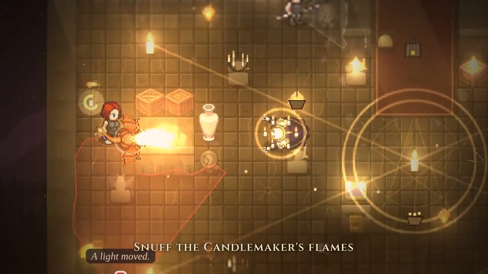

# Embercrown

A stealth-action prototype: a spy and her runt dragon infiltrate feuding houses to stop an engineered war. Inspired by the feel of N64 and PS1 classics, with all-new characters.

**Play it in your browser: https://dreamdreams77.github.io/EmberCrown/** (desktop or touchscreen; nothing to install).

A work in progress: all seven missions are playable end to end, mission 1 has had the most hands-on testing, and the art is being replaced with an original style (see [Where it stands](#where-it-stands)). A free, non-commercial project.

**Design doc:** see [PLAYBOOK.md](PLAYBOOK.md).

[](docs/trailer/embercrown-trailer.mp4)

**[Watch the 51-second trailer](docs/trailer/embercrown-trailer.mp4)**, recorded from the real game (rebuild it with `tools/trailer/make.sh`).

## Controls

| Action | Keyboard / mouse | Touch |
|---|---|---|
| Move | WASD / arrows | Drag the left side of the screen (floating joystick) |
| Strike (Shiloh) / Fire (Ashling) | Space, or left-click (aim with the mouse) | STRIKE / FIRE (hold) |
| Sneak / roll (Shiloh), Dash (Ashling) | Shift (tap twice, or C, to roll) | SNEAK toggle (double-tap to roll) / DASH |
| Interact: pick, steal, open, examine (hold) | E | ACT (hold) |
| Ember Nova (Ashling, after learning it) | E | NOVA (the ACT button) |
| Swap Shiloh and Ashling | Tab, or right-click | SWAP |
| Smoke / whisper bell / bone flute | Q / R / F, or click the slot | SMOKE / BELL / FLUTE |
| Wide scouting view | hold Z | tap the minimap |
| Pause, mute, minimap | Esc or P, M, N | Pause button |

The camera follows the action close-up on every screen size and leans toward threats. Portrait phones get a control panel under the game view, landscape devices overlay thumb controls at the corners.

## What's in the game

- **Seven missions**, three endings, three difficulties (Courier, Spy, Shadow). Stealth is still the core: guards see in cones, hounds smell, archers snipe, brutes carry shields.
- **Cinematics.** Every mission opens with a fly-over of its objectives, bosses make a dramatic entrance and fall in slow motion, and each mission ends on a victory sequence.
- **Action combat.** Shiloh strikes in a three-hit combo, takes guards down silently from behind, and rolls through danger. Ashling breathes fire, dashes (with invulnerability), and learns Ember Nova. Enemies telegraph every attack: Cinderlings lunge, Ashwisps fire orbs, Hollow Husks slam the ground. You have hearts, i-frames, knockback and hit-stop.
- **Boss fights.** The Bell-Warden slams, charges, leaps and tolls; the Candlemaker blinks, slashes, fires volleys and summons wisps while his candles shield him. Both have two phases and a stagger window that rewards good timing.
- **Furnished, lit worlds.** Auto-dressed rooms with tables, benches, bookcases, anvils, statues and breakable pots; chandeliers, rafters and doorway lintels in the foreground; a parallax scenery backdrop beyond the walls; distinct atmosphere in every area.
- **Exploration.** Each mission has a hidden **vault**: burn or dash through a cracked wall, light three braziers with Ashling's fire to open the inner gate, take the relic, survive the guardian trial, then open the reward chest. Examine glinting remains for story fragments; the Codex records everything.
- **Progression.** Cinders (from pots, foes, chests, secrets and rank) buy permanent talents at the **Ember Forge**: 12 upgrades across Shiloh, Ashling and shared branches, including extra hearts, Twin Dash, Ember Nova and Phoenix Spark. Relics, ember gems and S-C mission ranks still count.
- **The Back Stairs and case file.** Before each mission after the first you turn one servant of the house you are about to rob (three options each, each changing the mission and the house's opinion of you). The case file collects one clue per mission and shows where every house stands.
- **Saves.** Progress, talents, cinders, relics and settings persist in `localStorage` (older saves keep working). Cinders and relics are only banked when a mission is completed.
- **Audio.** Procedural music, ambient beds per area, and combat intensity layers. No asset files.

## Pixel art

Every mission, the hub and the dungeons are drawn through a **pixel pass** (`js/pixel.js`): the world renders into a small buffer at one pixel per world unit, the native size of the sprites, and is scaled up with hard edges, so sprites, tiles, props, light and vision cones share one pixel grid. World text (prompts, barks, floating words) is drawn afterwards at full resolution.

- **Characters** are Liberated Pixel Cup sprites. Shiloh and House Marrow's guards use ready-made sheets (`js/lpc.js`). Other houses' guards, archers and brutes, and every NPC, are assembled at run time from tinted layers (`js/lpcgen.js`, `assets/lpc/parts/`, rebuilt with `tools/build_lpc_parts.py`): soldiers wear their house colour, NPCs the colours in their `look`.
- **Props**: crates, barrels, tables, pots, urns, candle stands, wall torches, bones, webs and chains come from a pixel prop sheet (`js/lpcprops.js`, `assets/lpc/props.png`, rebuilt with `tools/build_lpc_props.py`).
- **Tiles**: every house and the Rookery have their own LPC floors and wall faces (`assets/lpc/tiles.png`, rebuilt with `tools/build_lpc_tiles.py`); outdoor zones keep the house art.
- **Bosses**: the Bell-Warden and the Candlemaker are large LPC figures driven by their fight states.
- **Still code-drawn** (on the pixel grid): Ashling, hounds, watch towers, the creatures (Cinderlings, Ashwisps, Husks, Pyre Mites, Warders, the Ashen Cantor), Dunmoor's masked guests, the Drowned Spire's sea and roofs, the Rookery floor, and props with no sprite yet.

Switch it with **Pixel art** in the pause menu to compare with the original drawn art. These assets keep their own licences (CC-BY-SA 3.0 / GPL 3.0 and others): see [CREDITS-LPC.md](CREDITS-LPC.md).

**HD-2D light** (on by default, **HD-2D light** in the pause menu) adds a colour grade per house, a vignette, tight bloom around flames, light shafts under torches and dust in the light. It deliberately adds no blur, which smears pixel art.

**Feel.** A guard who spots you jumps while the frame holds for a beat and the screen blinks red; running, rolling and striking kick up dust (sneaking does not); guards flash white when hit.

## Ember art (beta)

An original art style, drawn for this game, is being built to replace the LPC art. It is **off by default** and so far covers **Ashfall Keep only**: turn on **Ember (beta)** in the pause menu to see it there. Elsewhere the game keeps the pixel art above.

- **Characters**: Shiloh, two Marrow guards (Pell the pikeman, Sergeant Gaunt), the Cinderling, Ashling, Pip and Hale. Faces are a separate atlas drawn on the head every frame, so characters blink and react: calm, wary, alarmed, hurt, knocked out.
- **Ashfall Keep**: furnished room by room (`set:` in `LEVELS[0]`, checked by `tests/layout_ashfall.test.js`), its own floors, walls, rugs, doors, chests, braziers and mission mechanisms, and pixel-stepped light pools.
- **UI**: one skin for the HUD, menus and touch buttons, and painted title, briefing, victory and defeat screens.
- **Code and assets**: `js/ember.js`, `ember.css`, `assets/ember/` (built by `tools/ember_art/build_ember.py`). No third-party art, so as it spreads it removes the LPC licence dependency.

The plan for the other houses, the review screenshots from each round, and a redesigned Ashling (a small charcoal wyrmling with ember cracks, replacing the first Ember design) are on the `feature/ember-art-slice` branch (`docs/ember-art-slice/REPORT.md`).

## The opening

Ashfall Keep starts in the culvert under the keep, three small rooms that teach one thing each before the keep opens up: loose boards hung with bone chimes that rattle unless you sneak, a guard with his back turned (takedown), and a guard watching the ladder by the door (throw a bell to turn him away). A ladder then climbs into the keep. The culvert is a soft zone (`mech.soft`): suspicion builds at half speed there, and being caught sends Shiloh back to the start of it instead of ending the mission. Gadgets spent on a failed try come back. Once the ladder has been climbed, **Retry** after being caught in the keep starts at the top of the ladder instead of replaying the lessons (Begin and Restart still start over), and a last hint at the top explains how to get past the first guard. The rooms and hints are data in `LEVELS[0]` (`mech.lessons`, `mech.plates`, `mech.guards`, the `culvert` stairs marked `entry`); `tests/culvert.test.js` checks that each lesson can be done as taught.

## Project layout

```
index.html        page shell and touch control markup
style.css, ui2.css  responsive layout, menus, touch controls, Forge; ember.css: the Ember interface skin
js/data.js        missions, maps and vault generator, relics, lore
js/game.js        rules: stealth, gadgets, saves, main update
js/render.js      camera, baked tile layer, lighting, guards
js/world.js       props, particles, ambience, parallax, world draw pass
js/actors.js      Shiloh, Ashling, foes, bosses, combat effects
js/combat.js      hearts, foes, projectiles, strikes, bosses
js/tactics.js     guard teamwork and searching, hound scent, parry and counter, newer foes, the Ashen Cantor
js/abilities.js   Ashling's abilities and Shiloh's techniques
js/talents.js     Ember Forge talents
js/items.js       equipment, mastery and the quartermaster
js/mis_a.js       mission mechanics for missions 1-4: stairs, levers, plates, gates, trials, the culvert lessons
js/mis_b.js       missions 5-7: Ironvale, Dunmoor Marsh, the Candlemaker's Crown
js/dungeons.js    hidden optional dungeons under the missions (the Ember Warrens)
js/npcs.js        NPCs, dialogue, optional quests, house standing; data in js/npcdata.js
js/hub.js         the Rookery: home base between missions, quest chains
js/journal.js     the Journal (Hero, Gear, Forge, Quests, Case, Houses, Codex)
js/cine.js        cinematic director (intro, boss, victory)
js/props.js       furniture placement and art, foreground, vault interactables
js/tiles.js, js/atmos.js   per-house architecture and atmosphere
js/sprites.js, js/npcart.js, js/portraits.js   code-drawn figures, NPCs and dialogue portraits
js/hud.js         HUD, minimap, screen effects, title scene
js/ui.js          menus, Forge, pause, codex, touch and mouse input
js/audio.js       procedural music, ambience and sound effects
js/pixel.js       the pixel pass; js/lpc*.js: LPC characters, props and tiles; js/hd2d.js: HD-2D light
js/ember.js       Ember art (beta), with assets/ember/ (built by tools/ember_art/)
js/intro.js       the trailer on a first visit
js/main.js        boot, main loop, adaptive quality
tests/            Playwright suites, run by tests/run.js
```

## Run it locally and test

No build step. Serve the folder and open it in a browser:

```
npm run serve          # python3 -m http.server 8123, then open http://localhost:8123
```

Opening `index.html` directly also works. To run the tests (35 browser suites plus a syntax check, about five minutes):

```
npm install            # Playwright, once
npx playwright install chromium
npm test               # or: node tests/run.js culvert misa   (only suites whose names start with these)
```

The same suites run on every push and pull request (`.github/workflows/test.yml`). Pushing to `main` redeploys the live game on GitHub Pages.

## Where it stands

The full story is playable, seven missions ending in three possible endings (crown a puppet, burn it all down, or break the throne). Missions: Ashfall Keep, Gallowmere, the Drowned Spire (a flight level), Thornwick Abbey (a boss dungeon with the Bell-Warden), Ironvale (a hostage escort through forge vents, ending in a choice), Dunmoor Marsh (one hall in two time states: a masked ball and its ruins, switched at pedestals with F), and the Candlemaker's Crown (a boss fight shaped by how your houses ended up). Your choices raise each house's Favor, Fear, or Ruin, which changes later missions. Pick Courier, Spy, or Shadow difficulty on the title screen with keys 1, 2, 3. See the roadmap in the playbook.

**Testing so far.** Mission 1's tutorial and the entrance to the keep were played with real keyboard and touch input, and the problems found there are fixed. Missions 2-7, both bosses and the three endings have been checked by the automated suites but have not had a full human playthrough yet. If you play it, the most useful feedback is where you got stuck or confused, anything that felt unfair, and whether your choices for the houses felt like they mattered.

**Art.** The look is still mixed: LPC pixel art by default, some figures still drawn in code, and the original Ember art as an opt-in beta in mission 1. The plan is to replace everything with the Ember style, one house at a time.

## Licence

The code is MIT ([LICENSE](LICENSE)). The LPC art keeps its own licences (CC-BY-SA 3.0 / GPL 3.0 and others), credited in [CREDITS-LPC.md](CREDITS-LPC.md). The Ember art is original to this project. Embercrown is free and non-commercial.
