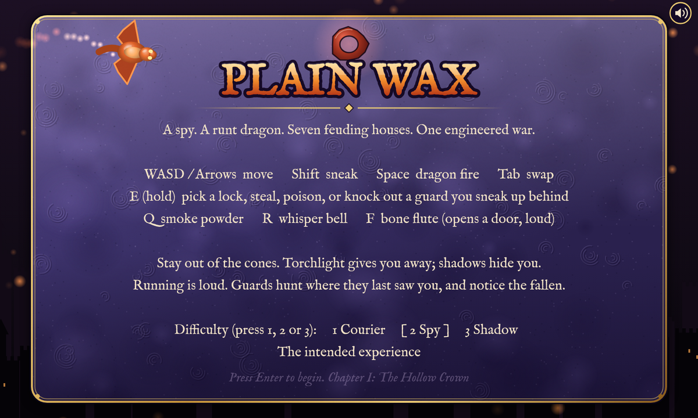
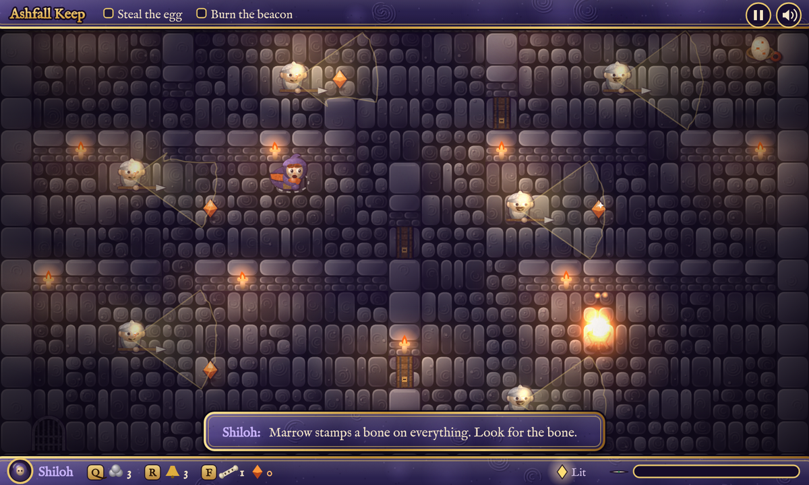
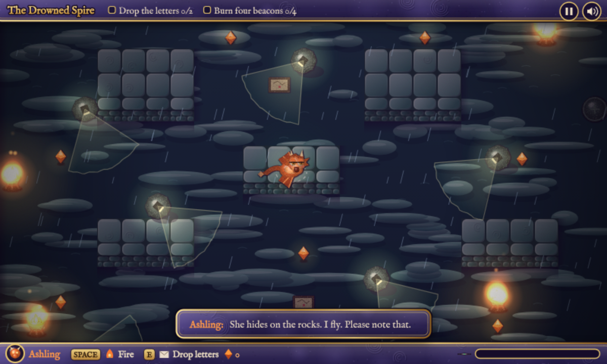
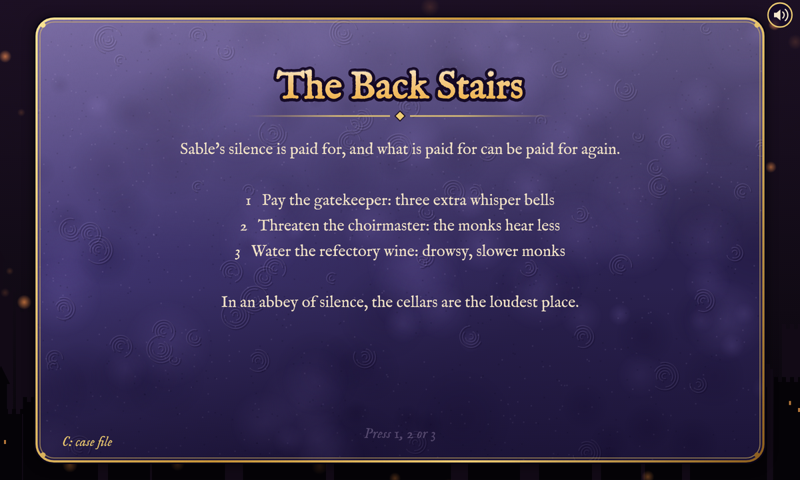
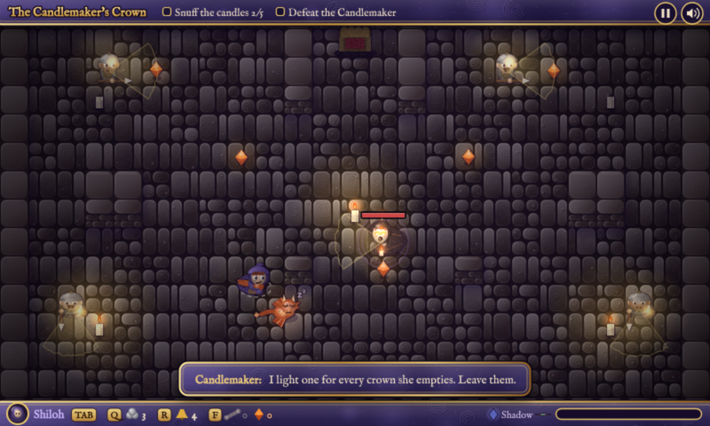
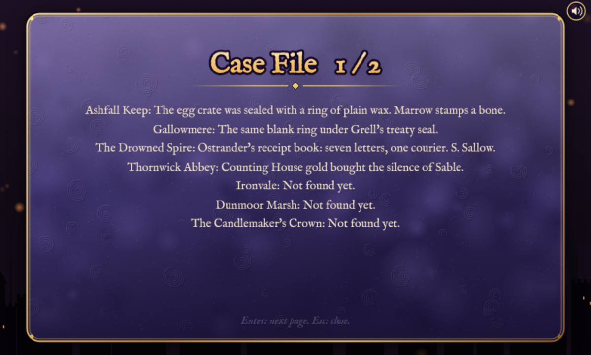

# Plain Wax

A small stealth game in plain JavaScript and canvas. (The repository is still called EmberCrown, the working title.) You play Shiloh, a courier turned spy, and Ashling, a runt dragon hatched from an egg she steals. Together they slip into the strongholds of seven feuding houses to stop a war someone is manufacturing.

**Play it:** https://dreamdreams77.github.io/EmberCrown/ or open `index.html` in a browser. There is no build step and no runtime dependency (the typeface loads from Google Fonts when online and falls back to Georgia).

This is an early prototype. Seven short missions are playable start to finish, with three endings.



| | |
|---|---|
|  |  |
| Ashfall Keep: shadows, torchlight, patrols. | The Drowned Spire: a flight mission as Ashling. |
|  |  |
| The Back Stairs: before each mission you turn one servant. | The finale: snuff the candles, then burn him from behind. |



## Controls

| | Keyboard | Touch |
|---|---|---|
| Walk | WASD or arrows | Drag anywhere. A short drag sneaks, a long drag runs |
| Sneak | Shift | Short drag |
| Pick a lock, steal, poison, snuff a candle, knock out a guard | Hold E next to it | Hold your finger still next to it |
| Dragon fire | Space (as Ashling) | Hold a second finger down (as Ashling) |
| Swap Shiloh and Ashling | Tab | Tap Tab in the bottom bar, or tap with a second finger |
| Smoke, whisper bell, bone flute | Q, R, F | Tap them in the bottom bar |
| Pause | P or Esc | Tap the pause button, top right |
| Case file | C (from a briefing, the Back Stairs or the pause menu) | Tap "Case file", lower left of those screens |
| Sound on, effects only, off | M | Tap the speaker, top right |
| New game (when a save exists) | N on the title screen | Tap the saved-game line on the title screen |

On a phone, turn it sideways. Nothing is drawn over the playfield except a faint ring under your thumb.

## How it plays

- Guards see in a cone, blocked by walls, doors and smoke. Standing in torchlight makes you easier to see; shadow hides you. Running is loud.
- A guard who loses you searches where he last saw you. Guards who find a fallen comrade raise the alarm. Suspicion fills when you are seen, and at 100% you are caught and the mission restarts.
- Shiloh is quiet and clever. Ashling is fast, fireproof and loud, and fire is the only way to burn signal beacons.
- Before each mission after the first you take the Back Stairs: turn one servant of the house you are about to rob (bribe, blackmail or sabotage). Each choice changes that mission and leaves a mark on the house.
- Your choices raise each house's Favor, Fear or Ruin, which changes later missions and the finale.
- The case file keeps the clues you have found and how each house feels about you.
- The game saves at the start of every mission. Close the page and press Enter on the title screen to continue.

The rules in full are in [DESIGN.md](DESIGN.md).

## What is not built yet

- Saving is per mission, not mid-mission: if you quit during a mission you start it again.
- Each mission is one screen with no scrolling, and the missions are short.
- Dialogue is single lines, not conversations.
- Ashling's growth only extends his flame reach. Gliding, charging and carrying are designed but not built.
- Planned but missing: the other flute songs, per-house effects on single missions, extra objectives on harder difficulties, split-screen co-op.
- Balance has had little real play testing. Phone performance and the audio mix are the least tested.

## Project layout

```
index.html        page shell and script tags
style.css         page and canvas styles
js/
  config.js       canvas, scale, constants
  levels.js       the seven missions as data (maps, guards, palettes)
  text.js         every word of the story: briefings, lines, barks, endings, menus
  story.js        game state, house reputation, outcomes, endings, difficulty
  world.js        collision, line of sight, loading a level
  audio.js        synthesized sound effects, generative music, mute
  input.js        touch and keyboard input, gadgets
  update.js       guard behaviour, interactions, detection, bosses, the frame update
  gfx.js          canvases, the clay material, baked level backgrounds
  sprites.js      characters and their faces
  props.js        items, doors, vents, smoke, particles
  scene.js        vision cones, lighting, overlays, drawing the world
  casefile.js     the case file screen
  ui.js           HUD, menus, title screen, main loop
test/             browser tests (Playwright)
```

The files are plain scripts loaded in order and share globals, so the game still runs by double-clicking `index.html`.

## Development

```
npm install
npx playwright install chromium   # once, for the tests
npm test           # about 30 seconds, headless Chromium
npm run format     # Prettier
```

The tests play the whole game with key presses, fuzz every mission with random input, and check the stealth and boss rules, touch controls, the audio engine, every character expression, that every line of the story exists and fits the screen, and that no text contains dashes.

## Credits and licence

Inspired by GoldenEye 007 (mission objectives, gadgets), Spyro the Dragon (gems, fire), Zelda 64 (songs that open things, bosses with rules) and the houses and betrayals of Game of Thrones. All characters, houses and places are original.

Built with AI assistance (Claude, by Anthropic); the commit history shows the changes.

Released under the [MIT licence](LICENSE).
